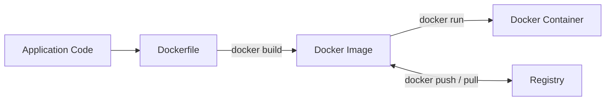
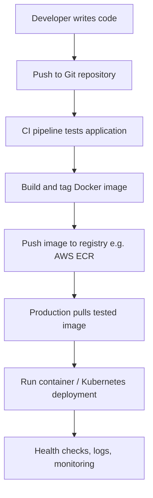

# 🐳 Day 2 — Docker Images & Dockerfiles

**Level:** Beginner → DevOps | **Duration:** 60–90 minutes | **Prerequisites:** Docker installed and daemon running

> **Goal:** Understand Docker images and Dockerfiles by packaging a Node.js HTTP application, inspecting image layers and build cache, using `.dockerignore`, and running different image versions.

## 1. Dockerfile vs Image vs Container

| Concept | Meaning | Simple analogy |
|---|---|---|
| **Dockerfile** | Instructions used to build an image | Recipe |
| **Docker Image** | Packaged, read-only application template | Prepared meal package |
| **Docker Container** | Running instance of an image | Meal being served |
| **Docker Registry** | Stores and distributes images | Warehouse |



**Remember:** `Dockerfile → docker build → Image → docker run → Container`.

## 2. Main Dockerfile instructions

| Instruction | What it does | Example |
|---|---|---|
| `FROM` | Chooses a base image | `FROM node:22-alpine` |
| `WORKDIR` | Sets the working directory | `WORKDIR /app` |
| `COPY` | Copies files from build context | `COPY app.js .` |
| `RUN` | Executes commands **at build time** | `RUN npm ci` |
| `ENV` | Defines environment variables | `ENV NODE_ENV=production` |
| `EXPOSE` | Documents an intended container port; does **not** publish it | `EXPOSE 3000` |
| `USER` | Chooses the runtime user | `USER node` |
| `CMD` | Sets the default container startup command | `CMD ["node", "app.js"]` |
| `ENTRYPOINT` | Configures the main executable | `ENTRYPOINT ["node"]` |
| `ARG` | Declares a build-time argument (not appropriate for secrets) | `ARG APP_VERSION=1.0` |

### `RUN` vs `CMD` vs `ENTRYPOINT`

- **RUN:** runs while building the image, such as installing dependencies.
- **CMD:** default executable or arguments when a container starts; can be overridden.
- **ENTRYPOINT:** sets the container's main executable; often combined with `CMD` for default arguments.

## 3. Hands-on Lab 1 — Build a Node.js application image

### Step 1 — Check Docker

```bash
docker --version
docker info
```

If `docker info` cannot reach the daemon, start Docker Desktop or your Linux Docker service before continuing.

### Step 2 — Create your project

```bash
mkdir -p ~/DevOps26/docker/day2
cd ~/DevOps26/docker/day2
```

### Step 3 — Create `app.js`

```bash
cat > app.js <<'EOF_APP'
const http = require('http');

const server = http.createServer((req, res) => {
  res.writeHead(200, { 'Content-Type': 'application/json' });
  res.end(JSON.stringify({
    message: 'Hello from Docker!',
    service: 'order-service',
    status: 'healthy'
  }));
});

server.listen(3000, '0.0.0.0', () => {
  console.log('Server running on port 3000');
});
EOF_APP
```

This app uses Node.js built-in modules: no `package.json` or `npm install` is needed for this first lab.

### Step 4 — Create `Dockerfile`

```bash
cat > Dockerfile <<'EOF_DOCKER'
FROM node:22-alpine

WORKDIR /app

COPY app.js .

EXPOSE 3000

USER node

CMD ["node", "app.js"]
EOF_DOCKER
```

### Step 5 — Build the image

```bash
docker build -t order-service:v1 .
```

- `-t`: name and tag the image.
- `order-service:v1`: repository name and version tag.
- `.`: current directory is the build context.

### Step 6 — Inspect the image

```bash
docker images
docker image inspect order-service:v1
```

### Step 7 — Run a container

```bash
docker run -d --name order-container -p 3000:3000 order-service:v1
```

**Port mapping:** `-p HOST_PORT:CONTAINER_PORT`. `EXPOSE 3000` by itself does not make the service reachable from your host.

### Step 8 — Test it

```bash
curl http://localhost:3000
```

Expected response (JSON field order may vary):

```json
{"message":"Hello from Docker!","service":"order-service","status":"healthy"}
```

### Step 9 — Inspect the running container

```bash
docker ps
docker logs order-container
docker exec order-container node --version
```

## 4. Hands-on Lab 2 — Image layers & caching

Docker images consist of filesystem layers, and builds can reuse cached steps when their inputs haven't changed.

```bash
docker history order-service:v1
docker images order-service
```

Modify source code, then rebuild:

```bash
sed -i 's/Hello from Docker!/Docker Day 2 Updated!/' app.js
docker build -t order-service:v2 .
docker history order-service:v2
```

**What to notice:** Docker can reuse the base image and previous unchanged steps. The `COPY app.js .` step is affected by your source change, while subsequent steps may be reprocessed.

> **Important:** Rebuilding an image does **not** update an already-running container. You must create a new container from the new image to run the updated code.

## 5. Hands-on Lab 3 — `.dockerignore`

Create a `.dockerignore` file to prevent unnecessary or sensitive local files from entering the build context:

```bash
cat > .dockerignore <<'EOF_IGNORE'
node_modules
.git
*.log
.env
.env.*
coverage
.DS_Store
EOF_IGNORE

docker build -t order-service:v3 .
```

**Why it matters:** Fewer files in the build context, fewer accidental inclusions, and often faster builds. Still handle secrets properly; `.dockerignore` alone is not a secrets-management system.

## 6. Hands-on Lab 4 — Tags and multiple versions

Create a second running container using the updated `v2` image:

```bash
docker run -d --name order-container-v2 -p 3001:3000 order-service:v2
```

Compare responses:

```bash
curl http://localhost:3000  # Original v1 container
curl http://localhost:3001  # Updated v2 container
```

Tag the first image:

```bash
docker tag order-service:v1 order-service:stable
docker images order-service
```

A **tag** is a movable reference; for precise production deployments prefer unique version tags or immutable image digests.

## 7. Production Dockerfile pattern (Node.js with dependencies)

For an actual project that has `package.json`, `package-lock.json`, and `server.js`:

```dockerfile
FROM node:22-alpine

WORKDIR /app

COPY package.json package-lock.json ./
RUN npm ci --omit=dev

COPY . .

ENV NODE_ENV=production
USER node
EXPOSE 3000
CMD ["node", "server.js"]
```

**Why copy package files first?** The dependency-installation step can remain cached when only source files change.

**Production considerations:**

- Use a maintained, appropriately sized base image and review its vulnerabilities.
- Pin dependencies with a lockfile; consider immutable base image digests.
- Use a non-root user and ensure required file permissions.
- Use multi-stage builds when compilation or build tooling is needed.
- Pass secrets at runtime through suitable secrets mechanisms, not `ARG`, `ENV`, or baked-in files.
- Add appropriate health checks, resource limits, observability and image scanning in production.
- Alpine is small but may not be compatible with all native dependencies; choose a suitable base for your app.

## 8. Real production flow



Example: a food delivery company deploys its **Payment Service** using a versioned image. QA and production use the same tested image artifact, while credentials and environment-specific settings are injected separately.

## 9. Troubleshooting cheat sheet

| Problem | What to check |
|---|---|
| Cannot connect to Docker daemon | `docker info`, Docker service/permissions |
| Port 3000 is already in use | `docker ps`, `ss -ltnp | grep :3000` |
| Container exits immediately | `docker ps -a`, `docker logs <name>` |
| App unreachable | `docker ps`, `docker port <name>`, app listening on `0.0.0.0` |
| Unexpected old app response | Image tag and container version; rebuild **and recreate** container |
| Image seems too big | `docker images`, `docker history <image>` |
| `COPY` fails | Verify filenames, build context and `.dockerignore` |

Useful commands:

```bash
docker ps -a
docker logs order-container
docker inspect order-container
docker history order-service:v1
docker stats
```

## 10. Practice assignment ✅

- [ ] Create `app.js` and `Dockerfile`.
- [ ] Build `order-service:v1`.
- [ ] Run `v1` on host port 3000.
- [ ] Test the API using `curl`.
- [ ] Check image layers with `docker history`.
- [ ] Change the response message and build `v2`.
- [ ] Create `.dockerignore`.
- [ ] Run `v2` on host port 3001 and compare both versions.
- [ ] Explain `FROM`, `RUN`, `COPY`, `CMD` and `EXPOSE` in your own words.

### Mini interview quiz

1. What is the difference between Dockerfile, image and container?
2. What does the final `.` in `docker build -t app:v1 .` mean?
3. How are `RUN` and `CMD` different?
4. Does `EXPOSE 3000` publish a port to the host?
5. Why do we copy `package*.json` before other source files in many Node.js Dockerfiles?
6. Does rebuilding an image change a running container automatically?
7. What is `.dockerignore` used for?
8. Why can immutable image digests be useful in production?

<details>
<summary><strong>See short answers</strong></summary>

1. Instructions → package/template → running instance.
2. It selects the current directory as build context.
3. `RUN` is build-time; `CMD` defines a default runtime command.
4. No; publish with `-p` or another networking method.
5. To improve dependency layer caching.
6. No; recreate the container from the new image.
7. To exclude files from the build context.
8. They refer to specific image content, avoiding mutable-tag surprises.

</details>

## 11. Cleanup

```bash
docker rm -f order-container order-container-v2
```

The command removes the lab containers but leaves images and source files intact.

## Further learning

- [Dockerfile reference](https://docs.docker.com/reference/dockerfile/)
- [Docker build cache](https://docs.docker.com/build/cache/)
- [Docker images](https://docs.docker.com/get-started/docker-concepts/the-basics/what-is-an-image/)
- [Multi-stage builds](https://docs.docker.com/build/building/multi-stage/)

---

**Next: Day 3 — Docker Container Lifecycle, Logs, Exec, Inspect & Troubleshooting.**
