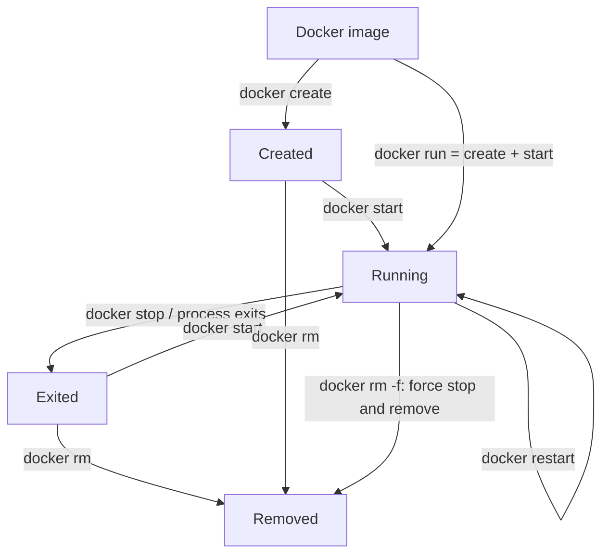

# 🐳 Day 3 — Docker Container Lifecycle

> **30-Day DevOps Learning Challenge | Hands-on Docker Lab**  
> **Level:** Beginner → Production | **Time:** 45–60 minutes

## 🎯 Learning objectives

By the end of this lab, you will be able to:

- Explain the difference between `docker create`, `run`, `start`, `stop`, `restart`, and `rm`.
- Identify running, created, and exited containers.
- Inspect container state, exit codes, restart policy, IP addresses, logs, and resource usage.
- Troubleshoot an application container that unexpectedly exits.
- Clean up lab containers safely.

## 1. What is the container lifecycle?

A Docker **image** is a template. A Docker **container** is an instance of that image. A container has a lifecycle: it can be created, started, stopped, restarted, inspected, and removed.



| Command | What it does | Container retained? |
|---|---|---|
| `docker create` | Creates but does not start a container | Yes |
| `docker run` | Creates and starts a new container | Yes, unless `--rm` |
| `docker start` | Starts an existing stopped or created container | Yes |
| `docker stop` | Requests a graceful shutdown | Yes |
| `docker restart` | Stops and starts the same container | Yes |
| `docker inspect` | Displays detailed JSON metadata | Unchanged |
| `docker rm` | Removes a stopped/created container | No |
| `docker rm -f` | Force-removes even a running container | No |

> **Production note:** A running container is not automatically a healthy application. Always verify health checks, logs, and actual API responses.

## 2. Real-world scenario: Order Service stopped responding

Imagine an online food-ordering app. Customers report that the **Order Service** is unavailable. Your investigation starts with:

1. Is the container running? `docker ps -a`
2. Why did it stop? `docker logs` and `docker inspect`
3. Was it killed due to memory pressure? Check `OOMKilled` and host logs.
4. Does restarting it help? Restart only after understanding the impact.
5. Is the service serving requests? Test its HTTP endpoint.

## 3. Prerequisites

A Linux machine with Docker Engine installed and access to the Docker daemon.

```bash
docker --version
docker info
docker ps
```

If these commands fail due to daemon connectivity or permissions, resolve that first. You do **not** need Node.js installed for the Nginx lab.

## 4. Lab 1: Create, start, and test an Nginx container

### Step 1 — Pull an image

```bash
docker pull nginx:alpine
```

### Step 2 — Create without starting

```bash
docker create --name my-nginx -p 8080:80 nginx:alpine
docker ps -a
```

The status should be **Created**. Nothing is listening on host port 8080 yet.

### Step 3 — Start

```bash
docker start my-nginx
docker ps
curl -I http://localhost:8080
```

Expect an HTTP response such as `200 OK` from the Nginx welcome page.

### Step 4 — Stop gracefully

```bash
docker stop my-nginx
docker ps
docker ps -a
```

The container should show **Exited** in `docker ps -a`. `docker stop` sends the configured stop signal (typically `SIGTERM`) and, if the process does not exit before the timeout, forces termination.

### Step 5 — Start again, then restart

```bash
docker start my-nginx
docker restart my-nginx
curl -I http://localhost:8080
```

**Important:** Restarting a container does not rebuild the image or introduce changed source code.

## 5. Lab 2: `docker run` vs `docker start`

```bash
# Creates and starts a NEW container
docker run -d --name nginx-second -p 8081:80 nginx:alpine

# Starts an EXISTING container (when it is stopped)
docker stop nginx-second
docker start nginx-second

curl -I http://localhost:8081
```

| `docker run` | `docker start` |
|---|---|
| Creates a new container | Uses an existing container |
| Can specify image, ports and mounts | Keeps the existing configuration |
| Fails if its chosen name already exists | Requires a known existing container |

## 6. Lab 3: Inspect a container

```bash
# Full JSON metadata
docker inspect my-nginx

# Current state
docker inspect --format '{{.State.Status}}' my-nginx

# State, exit code and out-of-memory flag
docker inspect --format 'Status={{.State.Status}} Exit={{.State.ExitCode}} OOM={{.State.OOMKilled}}' my-nginx

# IP address(es) on attached networks
docker inspect --format '{{range .NetworkSettings.Networks}}{{.IPAddress}}{{end}}' my-nginx

# Restart count
docker inspect --format '{{.RestartCount}}' my-nginx

# Restart policy
docker inspect --format '{{.HostConfig.RestartPolicy.Name}}' my-nginx

# Configured port bindings
docker port my-nginx
```

### Common exit codes

| Code | Typical interpretation |
|---|---|
| `0` | Main process exited successfully |
| `1` | Generic process/application error |
| `125` | Docker CLI/daemon failed to run the container (often from `docker run`) |
| `126` | Specified command cannot be invoked |
| `127` | Command not found |
| `137` | Killed by `SIGKILL` (can be OOM, forced stop, or other cause) |
| `143` | Terminated with `SIGTERM` |

**Do not infer root cause from exit code alone.** For example, exit code 137 does not prove the kernel ran out of memory. Correlate it with `OOMKilled`, logs, and host events.

## 7. Lab 4: Logs, processes, and resource usage

Make sure `my-nginx` is running first:

```bash
docker start my-nginx  # If already running, Docker will report it
docker logs --tail 50 my-nginx
docker logs -f my-nginx            # Ctrl+C to stop following
docker stats --no-stream my-nginx
docker top my-nginx
docker exec -it my-nginx sh
```

Within the shell, try `ps` if available (minimal Alpine-based images may not include all familiar utilities), then `exit` to return to your Linux terminal.

## 8. Lab 5: Restart policy

```bash
docker run -d \
  --name production-nginx \
  --restart unless-stopped \
  -p 8082:80 \
  nginx:alpine

docker inspect --format '{{.HostConfig.RestartPolicy.Name}}' production-nginx
```

Restart policies include `no` (default), `on-failure`, `always`, and `unless-stopped`. They help recover containers but cannot fix broken application code. Note that manually stopping a container affects restart-policy behavior.

## 9. Lab 6: Remove containers safely

```bash
# Stop and remove this specific lab container
docker stop my-nginx
docker rm my-nginx

# Force-remove the other named lab containers
docker rm -f nginx-second production-nginx

# Confirm cleanup
docker ps -a
```

`docker rm` removes the container **not** its image. Files stored only in the container's writable layer are lost on removal. Use named volumes for persistent application data.

> Avoid `docker container prune`, `docker system prune`, or sweeping cleanup on shared/production hosts unless you have reviewed what will be deleted.

## 10. Production troubleshooting playbook

Replace `order-service` with your actual container name or ID.

```bash
# 1. Check whether the container exists and is running
docker ps -a --filter 'name=order-service'

# 2. Examine recent errors
docker logs --tail 100 --timestamps order-service

# 3. Read failure metadata
docker inspect --format \
  'Status={{.State.Status}} Exit={{.State.ExitCode}} OOM={{.State.OOMKilled}} Error={{.State.Error}}' \
  order-service

# 4. If running, observe CPU and RAM usage
docker stats --no-stream order-service

# 5. Inspect its startup configuration and restart policy
docker inspect order-service

# 6. Restart only when appropriate, then verify app endpoint
docker restart order-service
# curl -f http://localhost:<published-port>/health
```

**Practical production checks:** Verify container exit reason, service logs, the published port, application health, memory limits, upstream dependencies, and disk capacity. A successful `docker restart` is not proof the incident is resolved.

## 11. Quick command cheat sheet

```bash
docker ps                      # Running containers
docker ps -a                   # All containers
docker create ...              # Create without starting
docker run -d ...              # Create and start detached
docker start CONTAINER         # Start existing
docker stop CONTAINER          # Graceful shutdown
docker restart CONTAINER       # Stop then start
docker kill CONTAINER          # Send SIGKILL by default
docker logs -f CONTAINER       # Follow logs
docker exec -it CONTAINER sh   # Shell inside running container
docker stats CONTAINER         # Live resource usage
docker inspect CONTAINER       # JSON details
docker rm CONTAINER            # Remove stopped container
docker rm -f CONTAINER         # Force-remove
```

## 12. Exercises / assignment

- [ ] Pull `nginx:alpine`.
- [ ] Create `my-nginx` without starting it.
- [ ] Confirm the container's **Created** state.
- [ ] Start it and test port 8080 using `curl`.
- [ ] Stop it and confirm **Exited**.
- [ ] Restart it and check the HTTP response.
- [ ] Inspect `Status`, `ExitCode`, `OOMKilled`, `RestartCount`, IP, and port binding.
- [ ] Read Nginx logs and inspect resource usage.
- [ ] Create another container using `docker run` on port 8081.
- [ ] Run a container with `--restart unless-stopped`.
- [ ] Remove all **your own** lab containers.

## 13. Interview practice

1. What is the difference between `docker create`, `docker run`, and `docker start`?
2. What is the difference between `docker stop` and `docker kill`?
3. Does `docker stop` delete container data?
4. What does `docker inspect` show that `docker ps` does not?
5. Why might a container show `Exited (137)`?
6. What is the difference between a running container and a healthy service?
7. What are Docker restart policies and when would you use them?
8. If a container disappears after it exits, what Docker run option might explain it? (`--rm`)

## ✅ Day 3 summary

**Create → Start → Inspect → Stop → Restart → Remove**. These lifecycle operations are fundamental for debugging Dockerized applications in QA, staging, and production.

**Next:** Day 4 — Docker Networking: bridge networks, DNS, published ports, and how microservices communicate.

### Further reading

- [Docker container CLI reference](https://docs.docker.com/reference/cli/docker/container/)
- [Start containers automatically](https://docs.docker.com/engine/containers/start-containers-automatically/)
- [Docker inspect reference](https://docs.docker.com/reference/cli/docker/inspect/)
