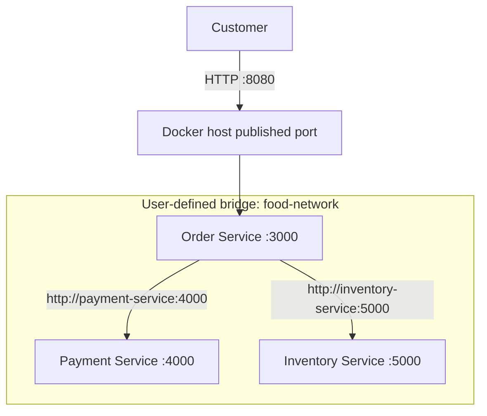
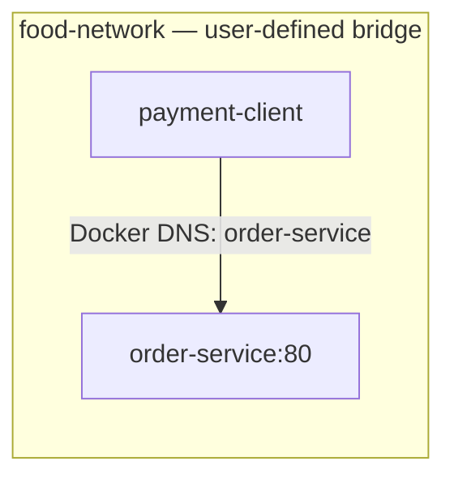
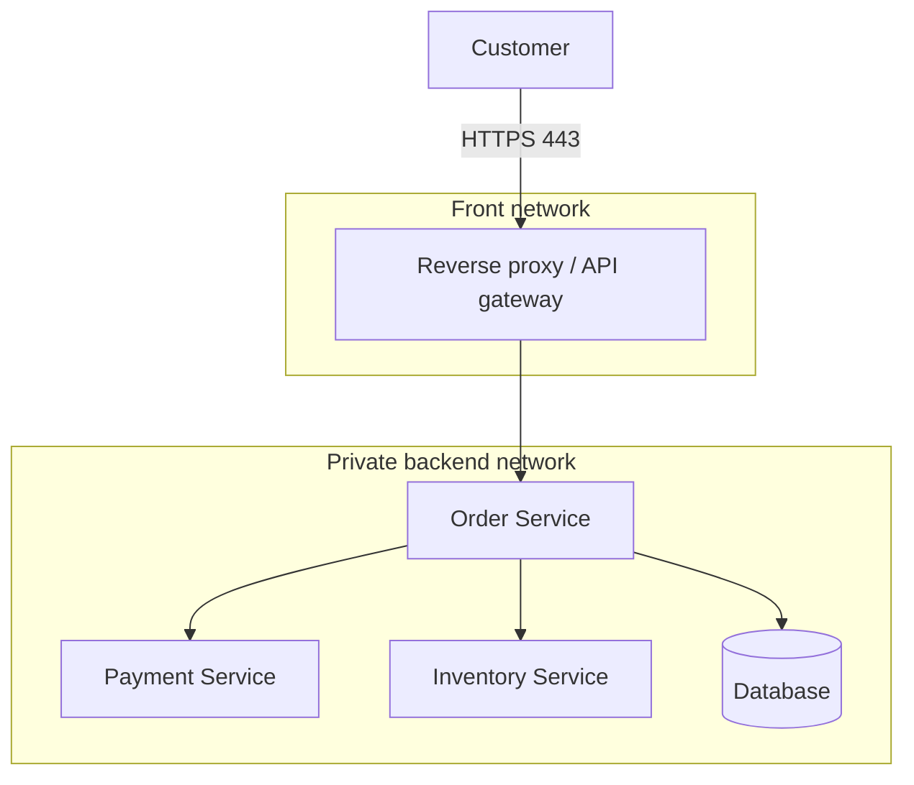

# 🐳 Day 4 — Docker Networking

> **30-Day DevOps Challenge | Hands-on Linux Lab**  
> Topics: Bridge • Host • None • Port Mapping • Docker DNS • Container-to-Container Communication

## 🎯 Learning objectives

By the end of Day 4, you should be able to:

- Explain why containers need networking.
- Compare **bridge**, **host**, and **none** network modes.
- Publish a container port to the host using `-p`.
- Connect containers to a user-defined bridge and reach them by **container name**.
- Troubleshoot DNS, port, network attachment, and application-listening problems.

**Prerequisites:** Docker Engine running on Linux (or Docker Desktop with Linux containers), a terminal, and `curl` on your host. Commands below use Bash. On Windows/WSL, run them in your Linux shell with Docker accessible.

---

## 1. 🛒 Production story: Food-delivery microservices

Imagine an online food-ordering app with:

- **Order Service** — accepts orders.
- **Payment Service** — handles payments.
- **Inventory Service** — checks stock.

Each service runs in its own Docker container. **Order Service must call Payment Service**, but you do not want to publish all internal services to customers. A Docker network connects services internally; only a reverse proxy or public-facing API needs an external port.



*The service ports above are illustrative. The hands-on exercises below use Nginx on port 80.*

## 2. Docker network types

| Mode | How it works | Typical use | Limitation |
|---|---|---|---|
| **Bridge** | Separate container network namespaces connected through a virtual bridge | Multiple services on one Docker host | Cross-host networking needs more infrastructure |
| **Host** | Container shares the host's network namespace | Specialized Linux networking requirements | Less network isolation; host port conflicts |
| **None** | No external networking; loopback only | Offline or deliberately isolated jobs | Cannot access other network endpoints |
| Overlay | Multi-host Docker networking | Docker Swarm services | Requires Swarm/network setup |

**Recommendation:** Use a **user-defined bridge network** for ordinary local multi-container applications. It includes automatic name-to-IP resolution for attached containers.

### Inspect the default networks

```bash
docker network ls
docker network inspect bridge
```

Common built-in networks include `bridge`, `host`, and `none`. Use `docker network ls` to confirm what exists in your environment.

---

## 3. Lab A — Create a user-defined bridge network

```bash
# Create a private network for the lab
docker network create --driver bridge food-network

# Verify its existence
docker network ls

# View subnets, gateway, and connected containers
docker network inspect food-network
```

> If the network already exists from an earlier attempt, reuse it instead of recreating it.

### Run a server inside the bridge

```bash
docker run -d \
  --name order-service \
  --network food-network \
  nginx:alpine
```

Notice there is **no `-p`**. The Nginx server is reachable by other containers on `food-network`, but its port has not been published to the host.

### Run a test client on the same network

```bash
docker run -dit \
  --name payment-client \
  --network food-network \
  alpine:3.20 sh

# Name-based communication via Docker's embedded DNS
docker exec payment-client ping -c 2 order-service

# HTTP request to Nginx in the other container
docker exec payment-client wget -qO- http://order-service:80
```

**Expected result:** The ping resolves `order-service` to an IP address and the HTTP command returns the Nginx welcome HTML.

**What happened?** Docker DNS resolved `order-service` automatically. Avoid hardcoding container IP addresses because they can change when containers are recreated.



### Inspect attachments

```bash
docker network inspect food-network

docker inspect \
  --format '{{json .NetworkSettings.Networks}}' \
  order-service
```

---

## 4. Lab B — Port mapping (host → container)

Use `-p HOST_PORT:CONTAINER_PORT` to publish a container port on the Docker host.

```bash
# Bind to the host's loopback interface: safe for local experiments
docker run -d \
  --name web-server \
  -p 127.0.0.1:8080:80 \
  nginx:alpine

# Run this on the Docker host
curl http://localhost:8080

# Display the published mapping
docker port web-server
```

```text
Host localhost:8080 ---> Nginx container:80
```

**Difference between `EXPOSE` and `-p`:** `EXPOSE 80` in a Dockerfile documents a port. It does **not** publish the port. `docker run -p ...` publishes it.

> `-p 8080:80` without an address typically binds on all host interfaces. Prefer `-p 127.0.0.1:8080:80` for local labs. External reachability also depends on the host firewall and Docker Desktop/VM configuration.

---

## 5. Lab C — Network isolation and connecting networks

```bash
docker network create isolated-network

docker run -dit \
  --name isolated-client \
  --network isolated-network \
  alpine:3.20 sh

# Normally fails: no DNS entry / direct connectivity for order-service here
docker exec isolated-client ping -c 2 order-service

# Attach that running client to food-network too
docker network connect food-network isolated-client

# Now it should resolve and connect
docker exec isolated-client ping -c 2 order-service
docker exec isolated-client wget -qO- http://order-service:80
```

Containers on different user-defined bridges cannot normally reach each other directly by their Docker names. A **published host port**, explicit network connection, or other routing design may still provide connectivity—network isolation is not a substitute for application authentication and firewall controls.

To disconnect the client:

```bash
docker network disconnect food-network isolated-client
```

---

## 6. Lab D — Host networking (Linux-specific behavior)

With `--network host`, the container uses the host's network namespace instead of a separate container network stack.

```bash
# Ensure host port 80 is free first
sudo ss -ltnp | grep ':80' || true

docker run -d \
  --name nginx-host \
  --network host \
  nginx:alpine

curl http://localhost:80
```

**Important:** `-p` is ignored in host networking; there is no separate container IP to publish. Host mode shares host ports and reduces network isolation.

**Docker Desktop caveat:** Host networking support depends on its version and settings and does not always behave identically to native Linux. Skip this lab if it is unavailable in your setup.

Stop and remove the host-mode test:

```bash
docker rm -f nginx-host
```

---

## 7. Lab E — None networking

```bash
docker run -dit \
  --name isolated-container \
  --network none \
  alpine:3.20 sh

# /proc/net/dev doesn't require a networking package
docker exec isolated-container cat /proc/net/dev

# Should not be able to reach another service
docker exec isolated-container wget -T 3 -qO- http://example.com || echo 'Network access unavailable, as expected'
```

Only the loopback network interface is available in normal `none` mode. The command can fail due to lack of DNS or connectivity; both are expected for this exercise.

---

## 8. The `localhost` trap

Inside `payment-client`, **`localhost` means `payment-client`**, not `order-service` and not the host machine.

| Address used inside `payment-client` | Meaning |
|---|---|
| `http://localhost:80` | Port 80 inside `payment-client` itself |
| `http://order-service:80` | Nginx container reachable on shared Docker network |
| `http://host.docker.internal:8080` | Docker Desktop's host access name; on native Linux may need explicit setup |

The application inside a container generally needs to listen on `0.0.0.0` (not only `127.0.0.1`) to accept connections from another container or a published host port.

---

## 9. Real production layout

A basic deployment keeps internal services unexposed:



Production tips:

1. Publish only required entry points; avoid exposing internal databases.
2. Use service names (Docker DNS) rather than fixed container IP addresses.
3. Apply network segmentation plus authentication, authorization, and firewall controls.
4. Use TLS for sensitive connections; don't put secrets into images.
5. In Kubernetes, pod networking and Kubernetes Services replace many standalone Docker networking patterns.

---

## 10. Troubleshooting cheat sheet

| Symptom | Check | Commands |
|---|---|---|
| Cannot reach container | Is it running? | `docker ps -a` |
| Name doesn't resolve | Are both on the same user-defined network? | `docker network inspect food-network` |
| Host port unreachable | Is port published? | `docker port web-server` |
| Port is already allocated | Is another process using it? | `sudo ss -ltnp \| grep ':8080'` |
| Container exits | What do logs show? | `docker logs --tail 100 web-server` |
| App listens only on localhost | Bind app to `0.0.0.0` inside container | Check app config and listening sockets |
| Unexpected network configuration | Inspect container | `docker inspect order-service` |

Useful commands:

```bash
docker network ls
docker network inspect food-network
docker ps -a
docker port web-server
docker logs --tail 100 order-service
docker inspect order-service
```

**Debugging example:** If the client cannot reach `http://order-service:80`, first verify both containers are running; then inspect network membership; then test name resolution; then test HTTP; finally inspect logs and service binding.

---

## 11. ✅ Day 4 assignments

- [ ] Run `docker network ls` and explain the three built-in drivers.
- [ ] Create and inspect `food-network`.
- [ ] Run `order-service` on `food-network` without exposing a port.
- [ ] Reach it by name from `payment-client`.
- [ ] Publish a separate Nginx container on `127.0.0.1:8080`.
- [ ] Demonstrate name-resolution failure on `isolated-network`.
- [ ] Attach `isolated-client` to `food-network` and retry successfully.
- [ ] Experiment with host networking where supported.
- [ ] Run a container with `--network none`.
- [ ] Clean up only the resources from this lab.

### Interview questions (with short answers)

**Q1. Bridge vs host network?**  
Bridge gives a separate container networking stack and Docker-managed virtual networking. Host shares the host's network namespace.

**Q2. Does `EXPOSE 3000` publish the port?**  
No. Use `-p`, such as `-p 127.0.0.1:8080:3000`.

**Q3. Why can two containers communicate by name?**  
Docker's embedded DNS resolves names on user-defined networks.

**Q4. Why doesn't `localhost` reach another container?**  
`localhost` refers to the calling container's own network namespace.

**Q5. Do different bridge networks guarantee complete security isolation?**  
No. Published ports and host/network policies can provide other paths. Use security controls as well.

**Q6. Can you join a running container to a network?**  
Yes: `docker network connect NETWORK CONTAINER`.

**Q7. What is the `none` driver for?**  
Workloads that do not need external network communication.

**Q8. Why not expose the database port publicly?**  
It increases attack surface; keep DB connections on restricted internal networks.

---

## 12. 🧹 Cleanup

**These commands remove the named lab containers. Do not run them if those names belong to existing workloads.**

```bash
# Remove containers created in this guide (Docker ignores missing containers only if handled separately)
docker rm -f order-service payment-client isolated-client web-server isolated-container

# If you ran the optional host-mode lab and didn't remove it yet:
# docker rm -f nginx-host

# Remove networks after containers have disconnected
docker network rm food-network isolated-network

# Verify
docker ps -a
docker network ls
```

> Cleanup will produce an error if some resources were never created. That's normal; remove only the names you actually used. **Do not run `docker network prune` on shared hosts.**

## 🔑 Final recap

- **Bridge:** Private container networking on a Docker host.
- **Host:** Container shares host networking.
- **None:** No external container networking.
- **Port mapping:** Maps `HOST_PORT` to `CONTAINER_PORT`.
- **Docker DNS:** Find other containers by name on user-defined networks.
- **Real production:** Publish only the front door; keep internal services private.

**Next: Day 5 — Docker Volumes & Persistent Storage:** named volumes, bind mounts, backup/restore, and protecting database data when containers are removed.

### Official references

- [Docker networking overview](https://docs.docker.com/engine/network/)
- [Bridge networking](https://docs.docker.com/engine/network/drivers/bridge/)
- [Host networking](https://docs.docker.com/engine/network/drivers/host/)
- [Port publishing](https://docs.docker.com/get-started/docker-concepts/running-containers/publishing-ports/)
