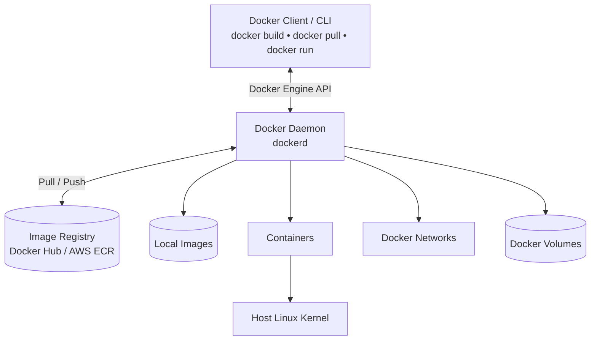
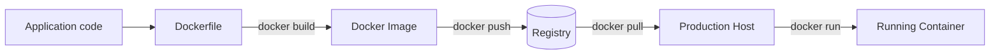
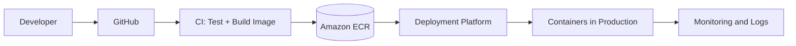

# 🐳 Docker: Architecture, Working & Hands-On Guide

> A beginner-friendly guide to Docker, from real-world problems to production deployment. Suitable for non-technical learners starting DevOps.

## 📚 Table of Contents

1. [What is Docker?](#1-what-is-docker)
2. [Why do we need Docker?](#2-why-do-we-need-docker)
3. [Real-world production example](#3-real-world-production-example)
4. [Docker architecture](#4-docker-architecture)
5. [How Docker works](#5-how-docker-works)
6. [Dockerfile vs Image vs Container](#6-dockerfile-vs-image-vs-container)
7. [Your first hands-on lab](#7-your-first-hands-on-lab)
8. [Docker networking](#8-docker-networking)
9. [Docker volumes](#9-docker-volumes)
10. [Essential Docker commands](#10-essential-docker-commands)
11. [Docker in production and CI/CD](#11-docker-in-production-and-cicd)
12. [Troubleshooting](#12-troubleshooting)
13. [Docker learning roadmap](#13-docker-learning-roadmap)
14. [Important interview questions](#14-important-interview-questions)

---

## 1. What is Docker?

**Docker is a platform for packaging and running applications in containers.** A container includes your application and the dependencies it needs, making deployments more consistent across compatible environments.

**Simple analogy:** A shipping container carries goods from one place to another. Docker packages software so the same application image can be used on a developer laptop, a testing server, and a production server.

> **Docker Image** = packaged application template. **Docker Container** = an instance created from that image.

## 2. Why do we need Docker?

Without Docker, teams often encounter:

- “It works on my machine” problems.
- Conflicting language or library versions.
- Time-consuming environment setup.
- Inconsistent deployment steps.
- Difficulty reproducing bugs across environments.

Docker helps by providing **repeatable builds, application isolation, portability, and easier deployment automation**. It does **not** automatically prevent crashes or guarantee security or zero downtime.

## 3. Real-world production example

Imagine a food delivery application with:

- **Order Service** — creates and tracks customer orders.
- **Payment Service** — processes customer payments.
- **Notification Service** — sends order updates.

**Problem:** Payment Service works on a developer laptop but fails after deployment because the production server has a different runtime or missing library.

**With Docker:** The team builds and tests a Payment Service image containing its required runtime and dependencies. The **same versioned image** is then deployed to production. This reduces environment drift (although external configuration, databases, and network dependencies still need careful management).

## 4. Docker architecture

Docker uses a **client–server architecture**.



### Main components

| Component | Role |
|---|---|
| **Docker Client** | The `docker` command-line tool that sends requests to Docker Engine. |
| **Docker Daemon (`dockerd`)** | Manages images, containers, networks, and volumes. |
| **Docker Host** | The machine or VM running Docker Engine. |
| **Docker Image** | Read-only layers used to create containers. |
| **Docker Container** | An isolated process with a writable container layer. |
| **Docker Registry** | Stores and distributes images, such as Docker Hub or Amazon ECR. |
| **Docker Network** | Connects containers to one another and to other systems. |
| **Docker Volume** | Stores persistent data independently of a container's lifecycle. |

**Under the hood:** Docker Engine integrates with `containerd` and OCI runtimes such as `runc`. Linux **namespaces** provide separation of system views; **cgroups** manage resource allocation and limits; layered filesystems enable image layers. Containers usually **share the host Linux kernel**, unlike full virtual machines. On macOS/Windows, Docker Desktop typically runs Linux containers inside a Linux VM.

## 5. How Docker works



1. Developer writes application code.
2. Developer writes a **Dockerfile** describing how to build the image.
3. `docker build` builds a **Docker image**.
4. The image is optionally pushed to a **registry**.
5. The production environment pulls the image.
6. The container runtime starts a **container** from the image.
7. Logs, metrics, networks, storage, and health checks are managed alongside the app.

## 6. Dockerfile vs Image vs Container

| Term | Analogy | Example |
|---|---|---|
| **Dockerfile** | Recipe | `FROM python:3.12-slim` |
| **Docker Image** | Prepared meal kit | `my-python-app:v1` |
| **Docker Container** | Meal being served | `docker run my-python-app:v1` |
| **Registry** | Warehouse | Docker Hub / ECR |

You can start multiple independent containers from the **same image**.

## 7. Your first hands-on lab

**Prerequisite:** Docker Engine or Docker Desktop installed and running. Verify:

```bash
docker version
docker info
```

### Step 1: Create a simple application

Create `app.py`:

```python
print("Hello from Docker!")
```

### Step 2: Create a `Dockerfile`

In the **same directory**, create a file named `Dockerfile` (no extension):

```dockerfile
FROM python:3.12-slim
WORKDIR /app
COPY app.py .
CMD ["python", "app.py"]
```

| Instruction | Meaning |
|---|---|
| `FROM` | Selects a base image. |
| `WORKDIR` | Sets the working directory in the image. |
| `COPY` | Copies files from the build context into the image. |
| `CMD` | Sets the default command when a container starts. |

### Step 3: Build the image

```bash
docker build -t my-python-app:v1 .
docker images
```

### Step 4: Run a container

```bash
docker run --name my-first-container my-python-app:v1
```

Expected output:

```text
Hello from Docker!
```

The container **exits normally** after printing the message: it is not supposed to remain running.

### Step 5: Inspect and clean up

```bash
docker ps -a
docker logs my-first-container
docker inspect my-first-container
docker rm my-first-container
```

### Bonus: Run an Nginx web server

```bash
docker run -d --name nginx-demo -p 8080:80 nginx:stable
```

Open `http://localhost:8080` and check the Nginx welcome page. Then clean up:

```bash
docker logs nginx-demo
docker stop nginx-demo
docker rm nginx-demo
```

## 8. Docker networking

A Docker network allows containers to communicate. For example, create a user-defined bridge network:

```bash
docker network create food-network

docker run -d --name order-service --network food-network nginx:stable
docker run -d --name payment-service --network food-network nginx:stable
```

Both containers share a network. Containers on this network can resolve each other by name, e.g. `payment-service`. These are **demo Nginx containers**, not working order/payment APIs.

Inspect and clean up:

```bash
docker network inspect food-network
docker rm -f order-service payment-service
docker network rm food-network
```

**Key concepts:** bridge networks, container DNS, published ports (`-p HOST:CONTAINER`), host networking, and network isolation.

## 9. Docker volumes

Containers have a writable layer, but data stored only there is lost when the container is removed. **Volumes** let you preserve data separately.

```bash
docker volume create mysql-data

docker run -d \
  --name mysql-demo \
  -e MYSQL_ROOT_PASSWORD=local-lab-only \
  -v mysql-data:/var/lib/mysql \
  mysql:8.4
```

Inspect:

```bash
docker volume ls
docker volume inspect mysql-data
```

Clean up the demo container (volume remains):

```bash
docker rm -f mysql-demo
```

> **Production safety:** Never hardcode real database passwords in commands or images. Use a secrets solution, backups, restricted access, and tested restore procedures. Do not remove volumes containing important data.

## 10. Essential Docker commands

| Task | Command |
|---|---|
| Check Docker | `docker version` |
| Engine details | `docker info` |
| Pull an image | `docker pull nginx:stable` |
| List images | `docker images` |
| Build an image | `docker build -t myapp:v1 .` |
| Run a container | `docker run -d --name web -p 8080:80 nginx:stable` |
| Running containers | `docker ps` |
| All containers | `docker ps -a` |
| Logs | `docker logs --tail 100 web` |
| Live logs | `docker logs -f web` |
| Shell in container | `docker exec -it web sh` |
| Inspect | `docker inspect web` |
| Resource usage | `docker stats` |
| Stop / start | `docker stop web` / `docker start web` |
| Remove container | `docker rm web` (after stop) |
| Networks | `docker network ls` |
| Volumes | `docker volume ls` |
| Disk usage | `docker system df` |

## 11. Docker in production and CI/CD

A common workflow:



**Example:** A Jenkins or GitHub Actions pipeline runs automated tests, builds an image, tags it with a version or commit SHA, scans it, pushes to ECR, and deploys it to a container platform such as ECS or Kubernetes.

**Production essentials:**

- Use immutable image versions/digests, not just `latest`.
- Use smaller, maintained base images and multi-stage builds where helpful.
- Run as a non-root user where possible and avoid unnecessary privileges.
- Keep secrets out of source code, Dockerfiles, and built images.
- Configure health checks, restart behavior, resource limits, and observability.
- Use persistent storage for stateful data and back it up.
- Plan rollbacks, security scans, and staged deployments.
- Keep **configuration** distinct from the image when appropriate.

> **Docker vs Kubernetes:** Docker helps build and run containers. Kubernetes orchestrates containerized workloads across machines. Modern Kubernetes nodes typically use a CRI-compatible runtime such as `containerd`, rather than needing Docker Engine.

## 12. Troubleshooting

Imagine customers report that **Payment Service is unavailable**. Begin by checking:

```bash
# Is the container running?
docker ps -a

# What does the application report?
docker logs --tail 100 payment-service

# CPU and memory usage
docker stats

# Container exit code, status, configuration
docker inspect payment-service

# Open a shell if it is running and includes sh
docker exec -it payment-service sh

# Network connectivity and configuration
docker network ls
```

| Symptom | What to investigate |
|---|---|
| Container exits immediately | Main process completed/crashed; check `docker logs` and exit code. |
| Port not reachable | Check `-p`, service listening address, firewall, and network. |
| `OOMKilled` | Memory usage and resource limits. |
| Image fails to build | Dockerfile, build context, dependencies, and `.dockerignore`. |
| Container cannot reach another | Network membership, DNS, destination port, credentials. |
| Data disappears after removal | Missing or incorrectly mounted persistent volume. |

## 13. Docker learning roadmap

- [ ] **Day 1:** Docker architecture, Engine, client, daemon, registry.
- [ ] **Day 2:** Dockerfile, images, layers, build cache.
- [ ] **Day 3:** Container lifecycle, logs, inspect, exec.
- [ ] **Day 4:** Networking, DNS, port mapping.
- [ ] **Day 5:** Volumes, bind mounts, data persistence.
- [ ] **Day 6:** Docker Compose with app + database.
- [ ] **Day 7:** Production Dockerfiles, multi-stage builds, `.dockerignore`.
- [ ] **Day 8:** Debugging, health checks, resource limits.
- [ ] **Day 9:** Image security, secrets, Docker Hub, AWS ECR.
- [ ] **Day 10:** CI/CD integration and deployment to cloud/Kubernetes.

## 14. Important interview questions

1. What is Docker, and why do organizations use it?
2. How do Docker images differ from containers?
3. Explain Docker client–server architecture.
4. What happens when you run `docker run nginx`?
5. What is a Dockerfile, and what do `FROM`, `COPY`, `RUN`, and `CMD` mean?
6. What is the difference between `CMD` and `ENTRYPOINT`?
7. What are namespaces and cgroups?
8. How does Docker networking work?
9. How do Docker volumes differ from bind mounts?
10. How would you debug a crashing container in production?
11. How do you reduce Docker image size?
12. How do Docker, containerd, and Kubernetes relate?

---

### ✅ Summary

**Dockerfile → Image → Container** is the core flow. Learn how Docker Engine manages images and containers; then practice networks, volumes, troubleshooting, security, CI/CD, and Kubernetes integration.

**Next hands-on project:** Package a Node.js REST API, connect it to a database with Docker Compose, and deploy it to a Linux server.

### Official references

- [Docker overview](https://docs.docker.com/get-started/docker-overview/)
- [Dockerfile reference](https://docs.docker.com/reference/dockerfile/)
- [Docker networking](https://docs.docker.com/engine/network/)
- [Docker volumes](https://docs.docker.com/engine/storage/volumes/)
- [Docker Compose](https://docs.docker.com/compose/)
